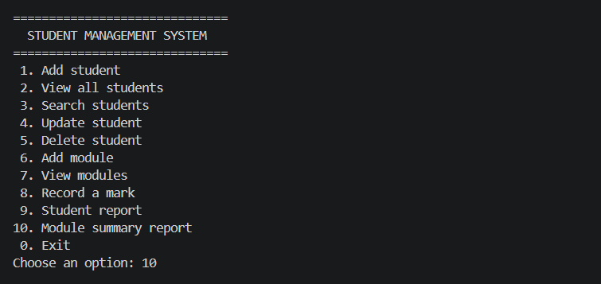
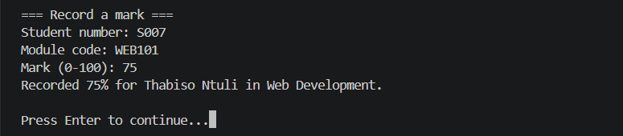
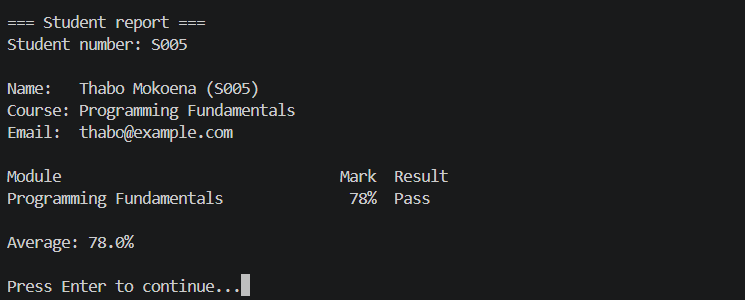
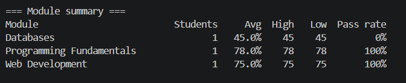

# Student Management System

A console application written in C# (.NET 8) for managing students, modules and marks. Data is saved automatically to a local JSON file, so nothing is lost when the program closes.

## Features

- Add, view, search, update and delete students
- Add and view modules (code, name, credits)
- Record marks per student and module (0-100); re-entering a mark replaces the old one
- Student report with each module result (Pass / Fail at 50%) and overall average
- Module summary report with average, highest, lowest and pass rate
- Input validation (required fields, email format, mark range, duplicate student numbers and module codes)
- Deleting a student also removes their marks

## Project structure

## Screenshots

### Main menu


### Recording a mark


### Student report


### Module summary report



```
StudentManagementSystem/
├── Program.cs                 Menu and user interaction
├── Models/                    Student, Module, Mark, AppData
├── Services/
│   ├── SchoolService.cs       Business logic (students, modules, marks, reports)
│   └── DataStore.cs           JSON file persistence
└── Utils/
    └── ConsoleHelper.cs       Validated console input helpers
```

## How to run

1. Install the [.NET 8 SDK](https://dotnet.microsoft.com/download).
2. Open a terminal in the project folder and run:

```
dotnet run
```

Data is stored in `data/sms-data.json`, which is created on first save.

## Concepts demonstrated

- Object-oriented design with separate models, services and utilities
- LINQ for searching, filtering and calculating statistics
- File handling and JSON serialisation (`System.Text.Json`)
- Input validation and error handling
- Separation of concerns (UI, logic and storage kept apart)

## Possible improvements

- Replace the JSON file with a SQL database
- Add unit tests for `SchoolService`
- Build a Windows Forms or WPF interface on top of the same services

## Author

Kamohelo Moorosi
